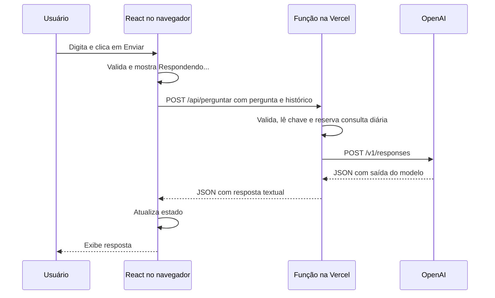

# Prévia visual: leia também a seção Revisão visual ao final

# Entenda o projeto inteiro

Leia primeiro as seções 1–5. Depois acompanhe os arquivos abertos ao lado deste guia. Para apresentar, use APRESENTACAO-15-MIN.md: não é necessário ler todo este documento em voz alta.

## 1. A ideia em uma frase

O usuário escreve uma dúvida; o React envia a dúvida a uma função; a função consulta a OpenAI e devolve um texto; o React atualiza a tela.

React não gera a explicação. Axios não gera a explicação. A IA externa gera; o nosso código organiza entrada, requisição e exibição.

## 2. Vocabulário sem complicar

| Termo | Significado neste app |
|---|---|
| Frontend | Código da interface que roda no navegador |
| Backend/servidor | Código que chama a OpenAI e guarda a chave longe do navegador |
| Componente | Função que devolve um pedaço de interface em JSX |
| JSX | Escrita parecida com HTML usada dentro do JavaScript do React |
| Props | Valores recebidos pelo componente: textos, booleanos ou funções |
| State/estado | Valor que o React guarda entre renderizações |
| Renderizar | Calcular e apresentar a interface correspondente aos estados |
| Evento | Ação como digitar ou enviar um formulário |
| HTTP | Protocolo de comunicação entre cliente e servidor |
| POST | Método HTTP usado aqui para enviar a pergunta no corpo da requisição |
| Endpoint/rota | Endereço de uma operação: /api/perguntar |
| JSON | Formato de texto estruturado usado na troca de dados |
| Promise | Representa uma operação que termina depois, com sucesso ou erro |
| Axios | Biblioteca que realiza as requisições HTTP |
| Chave/API key | Credencial secreta que autoriza a chamada à OpenAI |
| Token | Unidade de texto usada pelo modelo; não equivale exatamente a uma palavra |
| Build | Transformação do código-fonte em arquivos próprios para publicação |
| Mock/simulação | Substituto controlado do provedor para testar sem chamar a API real |

## 3. Percurso completo de uma pergunta

Exemplo didático: “Qual é a diferença entre props e state?”. O exemplo de resposta na demonstração é fixo; a chamada real local foi confirmada em 12/11/2026, conforme VALIDACAO.md.

1. `index.html` cria a div `root` e carrega `main.jsx`.
2. `main.jsx` coloca `App` dentro dessa div.
3. App começa com pergunta/erro vazios e mensagens como lista vazia e carregando falso.
4. `FormularioPergunta` recebe o valor de pergunta e a função `mudarPergunta` por props.
5. Ao digitar, `onChange` entrega um evento. `evento.target.value` é o texto atual do campo.
6. `setPergunta` guarda esse texto. O React renderiza novamente, e `value={pergunta}` mantém o campo sincronizado com o estado.
7. Ao enviar, `onSubmit` chama `enviarPergunta`. `preventDefault()` evita a submissão HTML tradicional e o recarregamento da página.
8. A função limpa o erro anterior, preserva a conversa e rejeita texto vazio depois de retirar espaços das pontas com `trim()`.
9. `setCarregando(true)` muda o botão e bloqueia novo envio enquanto espera.
10. `api.post('/perguntar', { pergunta: pergunta.trim(), historico: mensagens.slice(-6) })` envia JSON para `/api/perguntar`. O prefixo `/api` vem da baseURL.
11. A função de servidor valida os dados novamente. A validação do navegador melhora o uso, mas não impede que outra pessoa chame a rota diretamente.
12. Com chave configurada, o servidor envia POST à Responses API. O histórico validado e a pergunta entram no campo `input`.
13. A OpenAI responde com um objeto maior. O servidor percorre os itens de saída, retira somente os textos e devolve `{ resposta: '...' }`.
14. No navegador, `.then` recebe o retorno. O JSON já está convertido pelo Axios em `retorno.data`.
15. `setMensagens([...mensagens, { role: "user", content: pergunta.trim() }, { role: "assistant", content: retorno.data.resposta }])` acrescenta a troca; `setPergunta('')` limpa o campo e `setCarregando(false)` libera o formulário.
16. `Resposta` recebe os novos valores e mostra a explicação. Não precisamos alterar o HTML manualmente.



## 4. Os quatro estados do App

| Estado | Valor inicial | O que guarda | Quem altera |
|---|---|---|---|
| pergunta | '' | Texto do campo | mudarPergunta |
| mensagens | [] | Lista de perguntas e respostas | .then, após sucesso |
| carregando | false | Se há consulta aguardando | enviarPergunta, .then e .catch |
| erro | '' | Mensagem de falha ou validação | enviarPergunta, .then e .catch |

`const [pergunta, setPergunta] = useState('')` significa: pergunta é o valor atual; setPergunta é a função para alterá-lo; '' é o primeiro valor. Não fazer `pergunta = ...` para atualizar a tela.

O if de carregando e o botão desabilitado evitam reenvios comuns pela interface. Não são controle global de acesso, quota nem proteção contra chamadas diretas à API.

## 5. Componentes e dados que circulam

### App.jsx — coordena a tela

- Imports trazem hook, componentes, cliente HTTP e CSS.
- Quatro chamadas de useState guardam apenas o necessário.
- `mudarPergunta(evento)` atualiza a entrada.
- `enviarPergunta(evento)` valida, liga carregamento e inicia POST.
- `.then(...)` trata sucesso; resposta textual ausente recebe mensagem de erro.
- `.catch(...)` trata HTTP de erro, indisponibilidade e timeout. Se o servidor enviou `erro`, usamos esse texto; senão, mensagem de conexão.
- Não existe retorno direto da IA na função de envio: a atualização acontece quando a Promise termina.
- JSX organiza cabeçalho, painel de conversa e rodapé.

> Branch `feat/chat-ui-21st` (13/11/2026): a interface virou um chat de IA em tela cheia, com componentes do 21st.dev, Tailwind CSS, Motion, ícones Lucide e fonte Inter. A lógica do App (estados, POST, histórico) não mudou. Detalhes em "Chat de IA com componentes do 21st.dev", no fim deste guia.

### App.jsx — o que mudou nesta branch

- `enviar(texto)` concentra validação e requisição. É usada pelo formulário (`enviarPergunta`, que chama `preventDefault` e depois `enviar(pergunta)`) e pelas sugestões da tela inicial (clicar envia o texto da sugestão).
- `novaConversa()` limpa `mensagens`, `pergunta` e `erro`. O botão só aparece quando há mensagens e fica desabilitado durante a espera.
- `MotionConfig reducedMotion="user"`: se o sistema do aluno pede menos animação, o Motion desliga os movimentos.

### FormularioPergunta.jsx — entrada e envio

- Recebe `pergunta`, `aoMudar`, `aoEnviar` e `carregando`.
- `aoMudar` e `aoEnviar` são funções; passamos a referência, sem `()` no JSX, para executar somente no evento.
- `form onSubmit` continua sendo o ponto de envio; o botão do componente é `type="submit"`.
- `label htmlFor="pergunta"` (escondido visualmente com `sr-only`) associa rótulo ao campo.
- Repassa os valores ao componente `AIInputWithLoading` (Kokonut UI): `value`, `onChange`, `loading` e `maxLength={2000}`. O servidor também confere o tamanho.

### Painel.jsx — props e children

Recebe `titulo`, `subtitulo`, `status`, `acao` e `children`. Desenha o cabeçalho fixo (marca, título, selo de status e o botão recebido em `acao`). `children` é o que o App coloca entre `<Painel>` e `</Painel>`: a área da conversa e o formulário. `h-dvh` faz o painel ocupar a altura visível da tela, inclusive no celular.

### Resposta.jsx — situações visuais

- Lista vazia: tela de boas-vindas com quatro sugestões (duas no celular). `aoEscolherSugestao` vem do App.
- Conversa: `map` desenha cada mensagem. Pergunta = `ChatBubble variant="sent"` (balão verde à direita). Resposta = `ChatBubble layout="ai"` (avatar e texto em largura total, como chats de IA).
- Carregando: a pergunta enviada já aparece como balão; abaixo, `ChatBubbleMessage isLoading` mostra os três pontos animados.
- Erro: aviso com `role="alert"`, tanto na tela inicial quanto na conversa.
- `itens` junta `mensagens` e a pergunta pendente. Como a pergunta pendente ocupa a mesma posição (key) que terá na lista, ela não pisca quando a resposta chega.
- `motion.div` com `initial`/`animate`: cada mensagem surge de baixo, suavemente. `AnimatePresence mode="wait"` troca a tela inicial pela conversa.

O texto aparece dentro de `{mensagem.content}`; React o trata como texto, não como HTML executável.

### services/api.js — o endereço de nossa função

`axios.create` cria um cliente com baseURL `/api` e timeout de 60 segundos. Esse arquivo não chama diretamente a OpenAI e não contém credencial. `api.post('/perguntar', objeto)` junta base e caminho. A barra de `/api` aponta para o mesmo site que serviu a tela. O tempo cobre a reserva no contador (até 8 segundos) e a OpenAI (até 45 segundos).

### main.jsx — início do React

Importa React e ReactDOM. `document.getElementById('root')` localiza o ponto de entrada. `createRoot(...).render(...)` monta App. StrictMode executa verificações adicionais em desenvolvimento; nossa chamada só acontece por evento, não ao montar o componente.

## 6. Função de servidor — a única exceção técnica

Arquivo: `api/perguntar.js`. Esta parte não foi encontrada nas aulas React; foi aceita por Miguel para manter a chave no servidor. É essencial dizer isso na apresentação.

### Entrada e saída

Entrada do navegador:

```json
{ "pergunta": "Qual é a diferença entre props e state?", "historico": [] }
```

Saída de sucesso (exemplo de formato, não resposta real):

```json
{ "resposta": "Texto produzido pela IA." }
```

Saída de erro:

```json
{ "erro": "A integração com a OpenAI ainda não foi configurada." }
```

### Cada bloco da função

1. Importa Axios, a mesma biblioteca usada no navegador, agora executando no Node.
2. `json(dados, status)` centraliza resposta JSON e headers. `no-store` pede que não guardem a resposta em cache; não significa eliminar logs do provedor. Os demais headers reduzem interpretações indevidas do conteúdo.
3. Exporta objeto com `async fetch(request)`, formato de função Node suportado pela Vercel. `async` permite usar `await` para aguardar leitura do corpo e chamada externa.
4. Aceita somente POST; outros métodos recebem 405 e header Allow.
5. Se o navegador envia Origin, compara com a origem da URL. Recusa outro site. Não é autenticação: um cliente fora do navegador pode omitir/falsificar Origin.
6. Exige Content-Type JSON; lê texto; recusa corpo excessivo; usa JSON.parse. Parse inválido recebe 400.
7. Verifica tipo string, ausência/vazio e limite de 2000 caracteres. Ignora campos extras enviados pelo cliente, como modelo ou instruções.
8. Lê `process.env.OPENAI_API_KEY`, disponível somente no servidor. Sem ela, retorna 503 antes de qualquer chamada externa.
9. Reserva uma das 50 consultas diárias usando `server/limite-diario.js`. Se esgotou, responde 429; se não consegue verificar, responde 503. Só após a reserva usa Axios POST para a OpenAI, com cabeçalho Authorization Bearer. A credencial nunca é devolvida ao cliente. Uma falha da OpenAI não devolve a reserva.
10. Envia `model`, `instructions`, `input`, `reasoning`, `max_output_tokens` e `store`.
11. Verifica status completed e array output. Uma resposta incompleta não é exibida como concluída.
12. Percorre mensagens e conteúdos para reunir partes output_text. Itens de raciocínio não são exibidos. Ausência de texto/refusa sem texto recebe mensagem genérica para reformular.
13. Retorna somente o texto em `{resposta}`.
14. No catch, traduz falhas para mensagens curtas. Nunca retorna nem registra o objeto completo de erro do Axios, que pode carregar a chave.

### Campos enviados à OpenAI

| Campo | Valor/objetivo |
|---|---|
| model | gpt-6-luna, validado com uma chamada real local |
| instructions | Orienta resposta curta em português, com exemplo, sem fingir fontes ou acesso ao curso |
| input | Até seis mensagens anteriores e a pergunta digitada |
| reasoning.effort | none; configuração usada nesta tarefa |
| max_output_tokens | 600; teto de tokens de saída, não uma contagem de palavras |
| store | false; não manter o objeto de resposta para recuperação posterior via API |
| timeout do Axios | 45 segundos; depois a função responde com erro de tempo |

O pedido de até 180 palavras é uma orientação ao modelo, não validação rígida. O texto pode conter erro e não conhece automaticamente o Moodle. Nova chamada recebe as últimas três trocas no campo input junto da pergunta atual.

### Códigos HTTP

| Código | Uso neste projeto |
|---|---|
| 200 | Resposta textual concluída |
| 400 | Pergunta/JSON inválido |
| 403 | Origem recusada |
| 405 | Método diferente de POST |
| 413 | Corpo excessivo |
| 415 | Content-Type inadequado |
| 429 | Limite diário do app atingido ou quota do provedor |
| 502 | Falha do provedor, resposta incompleta ou sem texto |
| 503 | Chave ausente, contador indisponível ou configuração rejeitada pelo provedor |
| 504 | Tempo de consulta excedido |

## 7. Estilo — App.css e Tailwind

Nesta branch o estilo é feito com **Tailwind CSS v4**: classes prontas escritas direto no JSX (`flex`, `px-4`, `rounded-2xl`...). Foi necessário porque os componentes do 21st.dev são escritos assim.

- `App.css` tem só três partes: `@import "tailwindcss"`, o tema (`@theme`) e regras de base.
- `@theme` define a fonte Open Sans (oficial do IF) e as cores com nomes do padrão shadcn (`primary`, `secondary`, `foreground`, `muted-foreground`, `border`). Assim `bg-primary` vira o verde do projeto.
- Responsividade: prefixo `sm:` vale a partir de 640px. Exemplos: `hidden sm:inline` (some no celular), `sm:grid-cols-2` (sugestões em duas colunas no computador), `max-w-[85%] sm:max-w-[75%]` (balões).
- Layout: `h-dvh flex flex-col` no Painel; a conversa (`main`) é a única parte que rola; cabeçalho e campo ficam fixos. A coluna de conteúdo tem no máximo 768px (`max-w-3xl`), centralizada.
- `pb-[max(env(safe-area-inset-bottom),0.75rem)]`: no iPhone, o campo não fica embaixo da barra de gestos.
- Foco visível em botões e no campo; texto do campo em 16px para o iPhone não dar zoom.
- Fonte: Open Sans, a fonte oficial da marca do IF (Manual da Marca 2015, pág. 16). Pacote `@fontsource-variable/open-sans`, importado em `main.jsx`; vai junto com o site, sem Google Fonts. Substituiu a Inter em 13/11/2026.

## 8. Configuração e arquivos auxiliares

| Arquivo/pasta | Para que serve |
|---|---|
| index.html | HTML inicial, idioma, título, viewport e ponto root |
| package.json | Nome, versões, scripts e requisito de Node |
| package-lock.json | Trava versões exatas de dependências diretas e indiretas para npm ci |
| node_modules/ | Bibliotecas instaladas; não entra no GitHub/ZIP |
| dist/ | Resultado de npm run build; gerado, não é código-fonte |
| .gitignore | Evita versionar dependências, build, configuração local, logs e segredos |
| .env.example | Nome esperado da variável, sem chave real; não é carregado automaticamente |
| vite.config.js | Plugins React e Tailwind e adaptador HTTP local para a função |
| src/components/ui/ | Componentes de terceiros adaptados (21st.dev): chat-bubble, message-loading, ai-input-with-loading |
| src/hooks/use-auto-resize-textarea.js | Hook que acompanha o campo da Kokonut: ajusta a altura ao texto |
| src/lib/utils.js | Função `cn`, que junta classes CSS |
| licenses/ | Licenças MIT dos componentes adaptados |
| vercel.json | Configura build, pasta de saída, duração da função e headers |
| tests/api.test.js | Verifica a fronteira com o provedor sem rede ou chave real |
| server/limite-diario.js | Reserva uma das 50 consultas no contador privado |
| tests/limite-diario.test.js | Verifica limite, concorrência, virada do dia e falhas |
| scripts/verificar-limite-real.mjs | Testa Blob em arquivo isolado e o remove; não chama OpenAI |
| README.md | Porta de entrada: execução, bibliotecas, links e situação |
| PRODUCT.md | Objetivo e o que não é este produto |
| ARCHITECTURE.md | Desenho do fluxo e separação navegador/servidor |
| DESIGN.md | Decisões visuais |
| AGENTS.md e CLAUDE.md | Orientações de manutenção para assistentes; não executadas pelo app |
| SEGURANCA.md | Referência genérica da metodologia, adaptada pelo escopo |
| docs/ESCOPO.md | Requisitos, decisões, exceções e pontos ainda abertos |
| docs/specs/01-consulta.md | Comportamento esperado da tela |
| docs/INVENTARIO.md | Estado inicial e ferramentas identificadas |
| docs/COMMITS.md | Regras de versionamento; sem trailer de IA |
| docs/DOCUMENTACAO.md | Regra de manter documentos coerentes com código |
| docs/MAPA-DAS-AULAS.md | Fonte curricular de cada parte |
| docs/EXPLICACAO.md | Este guia |
| docs/APRESENTACAO-15-MIN.md | Ensaio, falas, perguntas e respostas |
| docs/VALIDACAO.md | Evidências dos testes e o que falta conferir |
| docs/ENTREGA.md | Sequência de publicação e conferência do ZIP/links |

### vite.config.js em detalhes

`defineConfig` configura Vite e o plugin React. `apiLocal(mode)` cria um adaptador exclusivo do desenvolvimento. Seu middleware recebe `/api/perguntar`, lê o corpo com limite e o transforma em Request para a mesma função usada na Vercel. Depois transfere status, headers e corpo da Response para o navegador.

Com `--mode demonstracao`, retorna um texto fixo depois de 900ms. A espera permite ver o estado carregando. Esse ramo não lê chave nem chama a OpenAI. Só existe no servidor de desenvolvimento; build não o transforma em API de produção. Não é fallback automático quando a API falha.

`npm run preview` não ativa configureServer: serve somente dist. Para função real local, usar dev; para ensaio sem chave, demo. Importar a função na configuração Vite não a importa no App nem inclui chave no JavaScript do navegador.

### vercel.json em detalhes

framework vite, comando de build e saída dist permitem publicar o frontend. O arquivo dentro de api é a função. maxDuration de 60s é maior que o timeout externo de 45s. Não há regra de SPA para múltiplas rotas, pois só existe a raiz.

Headers limitam carregamento de conteúdo à própria origem, bloqueiam enquadramento por outro site, dispensam câmera/microfone/localização e reduzem envio de referência. Eles não substituem controle de uso e gastos. A configuração ainda precisa ser confirmada em deploy real.

## 9. Testes: o que provam e o que não provam

Os 18 testes usam `node:test` e `assert`, nativos do Node. `mock.method(axios, 'post', ...)` substitui a chamada HTTP por uma função controlada; nenhuma credencial real ou rede é usada. O valor de teste não é uma API key. Cinco testes verificam o contador com um armazenamento simulado, e um teste da rota garante que o bloqueio não chama OpenAI.

Testam método, origem, formato, JSON inválido, ausência/tipo/vazio, tamanho, chave ausente, extração de texto, resposta incompleta, erros do provedor e timeout. A simulação de sucesso confere que campos indevidos do cliente não escolhem modelo/instruções e que detalhes internos não vazam.

Isso verifica nossa lógica. Não comprova saldo, autorização da chave, acesso ao modelo, qualidade da IA, funcionamento na Vercel ou uso por terceiros. Esses pontos dependem de testes reais; a chamada local e o Blob real já foram verificados, conforme VALIDACAO.md. Build verifica empacotamento do frontend; não testa sozinho a função na nuvem.

## 10. Segurança e limites honestos

Chave em variável do React não fica secreta: código de navegador é inspecionável. Por isso a chave é do servidor. Também não basta usar .gitignore se alguém inserir a chave diretamente em um arquivo já versionado.

Há memória transitória em useState, sem banco; recarregar a página perde as mensagens. A OpenAI recebe o texto e possui suas próprias políticas de retenção. Não enviar dados pessoais. A resposta não substitui as fontes da disciplina.

Endpoint público sem autenticação pode ser chamado por terceiros. O limite global permite 50 tentativas por dia em Brasília. Não existe quota por pessoa: alguém pode consumir todas as vagas. Não limita chamadas de outros programas na mesma conta OpenAI. Falha do contador bloqueia a consulta. Veja [LIMITE-DIARIO.md](LIMITE-DIARIO.md) para entender cada bloco dessa infraestrutura adicional.

## 11. Fontes externas usadas apenas para a exceção de servidor

- [Responses API: contrato de entrada e saída](https://developers.openai.com/api/reference/resources/responses/methods/create).
- [GPT-6 Luna](https://developers.openai.com/api/docs/models/gpt-6-luna).
- [Chave da API fora do navegador](https://help.openai.com/en/articles/5112595-best-practices-for-api-key-safety).
- [Funções Node na Vercel](https://vercel.com/docs/functions/runtimes/node-js).

Consultadas em 12/11/2026. Não afirmar que estas páginas fazem parte do material da professora.


## Mascote no canto superior direito do painel
Imagem gerada por IA a pedido de Miguel, salva em public/assistente.png. App.jsx passa o endereço pela prop imagem ao Painel. Painel.jsx usa a tag HTML img no JSX. src aponta para o arquivo público; alt descreve a imagem para leitores de tela. width e height reservam espaço. A classe mascote define tamanho de 64 pixels no desktop e 56 no celular e object-fit: contain preserva a proporção, sem cortar a imagem. Não acrescenta estado, chamada à API ou biblioteca. É ilustração de um projeto acadêmico, não identificação de produto oficial da OpenAI.

O topo-painel usa display: flex e justify-content: space-between para separar o título à esquerda e o mascote à direita. A linha ocupa espaço normal no painel, evitando sobreposição das mensagens. A imagem aparece apenas quando a prop imagem existe.

## Textos da interface
O topo contém título e subtítulo de apoio aos alunos do IF. Identificação da disciplina, AA04, autoria, instituição e tecnologias ficam reunidas no rodapé. Removida a frase promocional de introdução; estados e orientações usam texto direto. Mantidos os limites e avisos que explicam o funcionamento. Mascote permanece no canto superior direito da conversa. Nenhuma alteração no consumo da API.
Revisão anti-slop: título menor sem espaçamento artificial entre letras, fundo neutro e bordas discretas. CSS puro; nenhuma alteração no fluxo React. Critérios e limites registrados em REVISAO-ANTI-SLOP.md.

## Organização de UI/UX
O painel tem cabeçalho, conversa e formulário separados por espaçamento e linhas discretas. Mensagens próprias alinham à direita (margin-left: auto); respostas à esquerda. max-width evita linhas longas e overflow-wrap quebra textos compridos. O formulário agrupa textarea e botão; flex organiza ajuda à esquerda e ação à direita. A media query empilha essa linha no celular. O mascote continua no canto superior direito. A informação de memória fica fora do painel, e a identificação acadêmica no rodapé. Não há altura fixa ou rolagem interna, nem novos hooks ou dependências. Painel usa padding por área, em vez de um único padding externo. Campos, limites e envio permanecem iguais.

## Repositório e automação
Código público: https://github.com/miguelvzs/assistente-estudos, branch development. .github/workflows/verificar.yml executa npm ci, npm test e npm run build em push e pull request. public/assistente.png é a imagem estática. docs/CHAT.md detalha histórico; specs/02-chat.md e specs/03-organizacao-chat.md definem conversa e interface. A API real local foi confirmada. A `main` é a branch de produção vinculada à Vercel; o estado da publicação está em VALIDACAO.md.

## Aviso de conexão
App passa a prop status ao Painel. import.meta.env.MODE informa o modo do Vite: demonstracao mostra aviso explícito de simulação. No modo real, mensagens.length maior que zero indica que já chegou uma resposta da API nesta sessão; antes disso, a tela aguarda a primeira resposta. Condições e props continuam básicas; a variável de modo é configuração do Vite, não um hook. O texto confirma uma resposta passada, sem garantir disponibilidade futura.
Conceito IF: o prompt do servidor orienta estudos gerais e técnicos; não limita perguntas a React. O subtítulo e o exemplo de matemática comunicam esse público. A paleta foi alterada em CSS e na imagem estática, sem nova biblioteca ou hook. Modelo, limite de 600 tokens e histórico permanecem iguais.

## Chat de IA com componentes do 21st.dev

Pedido de Miguel em 13/11/2026, na branch `feat/chat-ui-21st`: interface de chat de IA convencional, fonte Inter, componentes do 21st.dev aplicados, animações com Motion e layout responsivo. Esta seção substitui as descrições anteriores de mascote, Arial e mensagens alinhadas à esquerda.

### O que veio pronto e o que é nosso

| Parte | Origem | O que adaptamos |
|---|---|---|
| `components/ui/chat-bubble.jsx` | Chat Bubble, Jakob Hoeg (shadcn-chat), MIT | TypeScript → JSX; `cva` → objetos de variantes; `cloneElement` → props explícitas; avatar sem Radix; cantos arredondados maiores; layout `ai` sem borda superior |
| `components/ui/message-loading.jsx` | Mesmo pacote, MIT | Copiado; só `aria-hidden` |
| `components/ui/ai-input-with-loading.jsx` | AI Input With Loading, Kokonut UI, MIT | Texto e espera vêm do App (requisição real); removidos os temporizadores de demonstração; botão `submit`; botão verde quando há texto; animações Motion |
| `hooks/use-auto-resize-textarea.js` | Hook que acompanha o componente Kokonut | Só TypeScript → JavaScript |
| `App.jsx`, `Painel.jsx`, `Resposta.jsx`, `FormularioPergunta.jsx` | Nossos | Layout, sugestões, nova conversa, ligação com estado e API |

Fala sugerida: “Usei componentes abertos do 21st.dev como base, com licença MIT. Converti para JSX e liguei ao estado e à requisição do projeto. O controle das mensagens e a chamada à API continuam no App.”

### Bibliotecas novas

| Pacote | Para quê |
|---|---|
| `tailwindcss` + `@tailwindcss/vite` | Classes de estilo usadas pelos componentes do 21st.dev |
| `motion` (motion.dev) | Animações: entrada das mensagens, troca da tela inicial, toque no botão |
| `lucide-react` | Ícones (enviar, nova conversa, chapéu de formatura, brilho) |
| `@fontsource-variable/open-sans` | Open Sans, fonte oficial do IF, servida pelo próprio site |

Nenhuma delas recebe dados do aluno nem chama serviços externos.

### Conceitos novos para explicar

- **Hook `useRef`** (no hook do campo): guarda a referência ao `<textarea>` para medir a altura do texto (`scrollHeight`).
- **`useCallback` e `useEffect`** (no mesmo hook): recriam o ajuste só quando os limites mudam e recalculam ao girar o celular. O App continua sem `useEffect` para a requisição.
- **`useEffect` no campo**: volta à altura mínima quando o texto é limpo ou durante a espera.
- **Motion**: `motion.div` aceita `initial` (como começa) e `animate` (como termina). `AnimatePresence` deixa animar a saída da tela inicial. `whileTap` encolhe o botão ao tocar.
- **Callback ref `mostrarFinal`**: continua rolando a conversa até o trecho novo, agora com `behavior: 'smooth'`.

### Responsividade

- Celular (até 639px): cabeçalho só com título e ícone de nova conversa; duas sugestões; balões até 85% da largura; aviso curto abaixo do campo; espaço para a barra de gestos do iPhone.
- Computador (640px ou mais): subtítulo, selo de status e texto “Nova conversa”; quatro sugestões em duas colunas; atalhos de teclado visíveis.
- Coluna de leitura limitada a 768px em telas grandes.

### Fluxo preservado

`pergunta`, `mensagens`, `carregando` e `erro` continuam iguais. O POST continua sendo `api.post('/perguntar', { pergunta, historico: mensagens.slice(-6) })`. Servidor, limite de 50/dia e testes não mudaram.

### IFAI, guia de apresentação e sugestões do semestre

- **Nome e marca:** IFAI = símbolo oficial dos Institutos Federais (`MarcaIF.jsx`, SVG em domínio público, Setec/MEC) + “IF” em verde e “AI” em vermelho. Também é o ícone da aba (`public/ifai.svg`).
- **Paleta do IF:** verde `#2f9e41` e vermelho `#cd191e`. Balões e botões usam `#1f7a33` (verde do IF escurecido) porque texto branco sobre `#2f9e41` tem contraste 3,5:1, abaixo do mínimo de 4,5:1.
- **Botão Apresentação** (cabeçalho): abre `GuiaApresentacao.jsx`, painel lateral com abas Roteiro, Fluxo, React, API, Servidor, Interface, Tecnologias e Perguntas. Novo estado no App: `guiaAberto` (só interface). O guia tem estado próprio `aba`. Fecha com X, clique fora ou Esc. `AnimatePresence` anima a entrada e a saída.
- **Sugestões:** `Sugestoes.jsx` lê `conteudo/semestre.js` (6 matérias, 4 perguntas cada) e tem estado próprio `filtro`. Clicar chama `enviar(pergunta)` do App. Ver [CONTEUDOS-SEMESTRE.md](CONTEUDOS-SEMESTRE.md).
- **Lista de tecnologias e sites:** [TECNOLOGIAS.md](TECNOLOGIAS.md).
